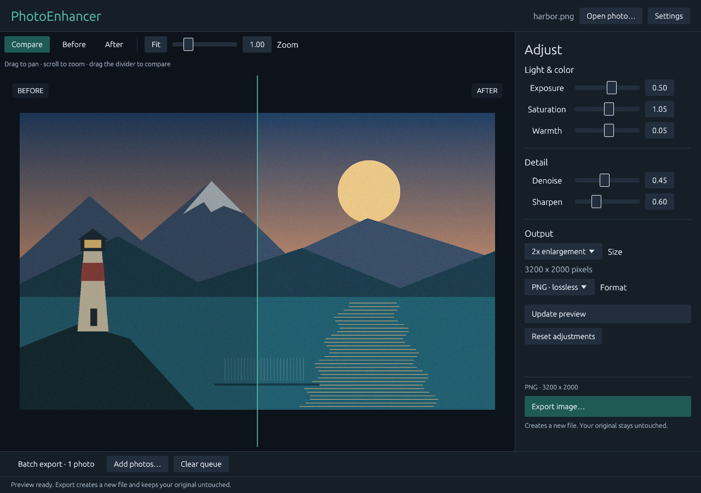
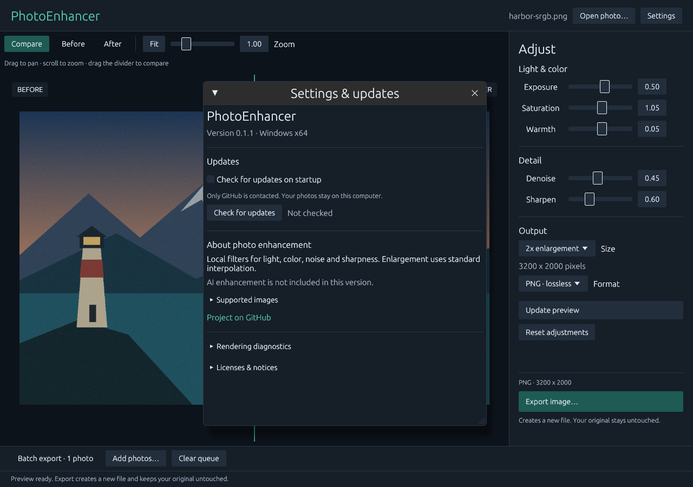

# PhotoEnhancer

A local photo workspace for Windows: reduce mild noise, adjust light and color, sharpen edges, and enlarge photos with deterministic interpolation. Written in Rust with an original egui interface. No account, model download, cloud inference, or paid API is required.

**Version 0.2.0.** Windows x64 with a CPU-rendered interface. UI languages: English, Russian, French, German, Spanish and Italian. Light and dark themes are included. Real-monitor color, OS-native interactions, and packaged updater installation still require manual validation. See the [canonical repository](https://github.com/siarheisinelnikau/photo-enhancer) for release availability.

## Screenshots

Historical v0.1.1 client-area captures from the executable, using the production UI and CPU rasterizer. The landscape is an original generated test fixture, processed by the application's actual enhancement engine. These captures exclude native window chrome and system dialogs. Updated v0.2.0 workspace and Settings screenshots, including the new language and theme controls, are pending because the current repository instructions prohibit GUI launches and screenshots. The images below document the preceding dark interface; they are not evidence of the new light theme or translated layout.



Workspace at 1280 × 900 logical pixels, 100% scale, opening an ICC-tagged sRGB fixture. The primary export action stays visible; batch controls expand when needed.



Settings in an isolated capture profile. Startup checks are disabled for capture; they are enabled by default in normal operation.

## What works in this version

- Change UI language instantly between English, Русский, Français, Deutsch, Español and Italiano in **Settings → Appearance → Language**. Choose **Light** or **Dark** beside **Theme**; both preferences persist across restarts. Existing settings retain their export options and startup-check opt-out.
- Open PNG/JPEG, automatically convert embedded RGB/grayscale ICC profiles to sRGB, apply EXIF rotation/mirroring, and compare before/after by dragging the labeled divider, with preview zoom and pan.
- Adjust exposure, saturation, and warmth in linear sRGB. Apply a fixed 3×3 edge-aware denoiser and an unsharp mask.
- Enlarge 1×–4× with bilinear interpolation in linear light and premultiplied alpha. This does **not** recover true lost detail or perform learned restoration.
- Render an explicit screen-size preview; export processes the original at full resolution using the current controls.
- Export PNG with an sRGB declaration and alpha, or JPEG with adjustable quality. Transparent JPEG export is refused. Metadata, including GPS, is removed after orientation is applied.
- Process a queue of up to 64 photos sequentially into a chosen output folder, with per-file status, cancellation, and collision errors. Originals and existing destination files are never overwritten.
- Check GitHub Releases in Settings, with the installed version, an enabled-by-default persistent startup-check toggle, and user-initiated **Download and install** plus restart. Checks and downloads run on a separate worker. A missing repository/release is reported as unavailable.

## Supported images and limits

This version accepts **8-bit RGB/grayscale PNG and JPEG**. Embedded ICC profiles, including sRGB, Display P3 and Adobe RGB, are converted locally to sRGB; the original file and alpha are preserved. Untagged inputs are assumed to be sRGB. Damaged, mismatched or unsupported profiles produce a specific error. CMYK/YCCK JPEG, non-sRGB PNG gamma/primaries without an ICC profile, HDR, animated PNG, and high-bit-depth inputs still require conversion to supported sRGB. RAW, TIFF, HEIC, AVIF and WebP are not implemented. The preview is not a calibrated, color-managed soft-proofing environment.

Files are limited to 128 MiB; input to 24 megapixels, output to 32 megapixels, and a conservative 512 MiB processing allocation plan. The combined allocation formula can reject images below the individual pixel limits. Full buffers are bounded rather than streaming arbitrarily large images from disk. Neighborhood operations have fixed support and use 64-row processing tiles; no full-frame float buffers or unbounded worker pools are used.

Preview images have a maximum 1280-pixel edge. Detail filters run after preview reduction, so they are an approximation of the full-resolution result. Preview zoom magnifies that preview, and preview rendering does not demonstrate the selected enlargement. Use an exported copy to inspect actual output detail. Cancellation is checked between rows and before output publication; a codec encode/decode already in progress must finish before cancellation takes effect.

## Use

1. Click **Open photo…** and adjust light, color, and detail in the right panel.
2. Click **Update preview**, then use Compare / Before / After and drag the divider. A notice marks previews that no longer match the controls.
3. Choose PNG or JPEG and click **Export image…**. The extension follows the selected format. Existing names are protected even if a save dialog permits selecting them.
4. For batches, expand **Batch export**, add photos, choose an output folder, set adjustments/format, then **Export batch**. Files use `original-stem-enhanced.png` or `.jpg`. Duplicate stems produce per-file collision errors; completed items remain saved when cancelling.
5. Open **Settings → Appearance** to choose your language and light/dark theme. Changes apply immediately and are saved automatically. The same Settings window contains update controls and the local model capability status.

Settings are stored in the per-user `PhotoEnhancer/data/preferences.json` application-data file, independently of the portable executable. The former `app.ron` preferences are read when upgrading from the initial OpenGL host; the legacy file is preserved. Photos are never uploaded. Only startup/manual update checks and user-initiated downloads contact GitHub. Disable **Check for updates on startup** to prevent startup update requests. Startup failures stay in Settings without pop-up dialogs.

## Shared updater dependency

The reusable release discovery, verified download, cancellation and Windows replacement logic now live in the sibling `rust-auto-updator` workspace. `src/updates.rs` contains only PhotoEnhancer configuration and helper routing. Check out that workspace alongside this repository as `../rust-auto-updator`; CI and source-only builds need the same layout. The build uses a local path dependency; CI provisions the pinned shared source automatically.

Startup checking remains asynchronous and optional; manual checking always remains available. Installation starts only after the user downloads a verified release and selects **Install and restart**. Settings and photos stay outside the replacement transaction. Historical releases with only a GitHub SHA-256 digest remain accepted; an available checksum file is also verified. Cleanup waits until the replacement renders its first successful frame.

The app is a window-based editor and has no tray icon or tray workflow. Its native window and taskbar icons now load the same multiresolution resources as the executable. The [native icon resource proof](docs/screenshots/icon-resources.png) shows those resources on light/dark backgrounds; it is not an OS screenshot.

## Build and package

Use Windows x64 with the Rust MSVC toolchain, the Windows SDK and C++ linker already installed. The initial implementation was checked with Rust/Cargo 1.96.1. Cargo declares Rust 1.95 as its dependency-resolution baseline; that older compiler itself has not been tested. The Windows CRT is linked statically. The interface is rasterized on the CPU with `egui_software_backend` and presented through Win32 GDI with `softbuffer`; the application has no OpenGL/Direct3D renderer. Windows desktop composition remains an OS responsibility. No GPU inference runtime is needed.

```powershell
# Run from this repository. These commands do not launch the GUI.
./scripts/check.ps1 -Offline
./scripts/package.ps1 -Offline
```

Drop `-Offline` on a development machine that needs to resolve the locked dependencies. Project Cargo configuration limits builds to two jobs and uses the local `target/`. The package script produces:

```text
dist/PhotoEnhancer-v0.2.0.exe
dist/SHA256SUMS.txt
dist/LICENSE
dist/THIRD_PARTY_NOTICES.txt
```

The standalone executable requires no adjacent model or runtime files. Keep the license notices when redistributing it. The package and check scripts prepare local artifacts without launching the application. Release publication is handled separately by the repository release workflow.

For dependency changes, regenerate notices with `python scripts/generate_notices.py --offline`; review both the dependency graph and license texts before publication.

## Repeat the visual and rendering checks

No computer-use automation is required. The developer-only modes parse before normal startup and do not read/write normal preferences, contact GitHub, or modify the input fixture.

```powershell
python scripts/generate_gui_fixtures.py
python scripts/review_ui.py --exe dist/PhotoEnhancer-v0.2.0.exe
python scripts/review_ui.py --exe dist/PhotoEnhancer-v0.2.0.exe --diagnose
python scripts/verify_windows_icon.py dist/PhotoEnhancer-v0.2.0.exe
```

The optional fixture/review scripts use Python with Pillow. Self-capture renders 16 bounded frames, writes PNG plus a manifest, then exits; it shares the production UI and rasterizer. Each invocation has internal and external deadlines. Review includes the standard and minimum-size workspace, settings at 125% scale, empty state, and a real decoding-error state. Inspect the resulting PNGs; exit success alone is not a visual review.

The separate native diagnostic creates one disposable non-activating window, samples visible idle for five seconds, hides it for five seconds, restores it, samples restored idle for three seconds, records CPU and separate layout/raster/present counters, then exits. This checks scheduling and GDI presentation, independently of the screenshots. It does not simulate OS input or establish subjective responsiveness. See the measured evidence and remaining checks in [VALIDATION.md](docs/VALIDATION.md).

## Models and architecture

Learned enhancement is explicitly **unavailable** in this build. A typed local inference adapter boundary is included, with no installed runtime, weights, or enabled download action. See [model integration requirements](docs/MODELS.md), [architecture](docs/ARCHITECTURE.md), [verification and pending manual checks](docs/VALIDATION.md), and the [release-note draft](docs/RELEASE_NOTES.md).

## License and independence

MIT; see [LICENSE](LICENSE) and [third-party notices](docs/THIRD_PARTY_NOTICES.txt), including the bundled fonts. The user-workflow reference was [Topaz Photo](https://www.topazlabs.com/topaz-photo). PhotoEnhancer is an independent implementation with original code and interface; it is not affiliated with Topaz Labs and contains no competitor assets or models.
